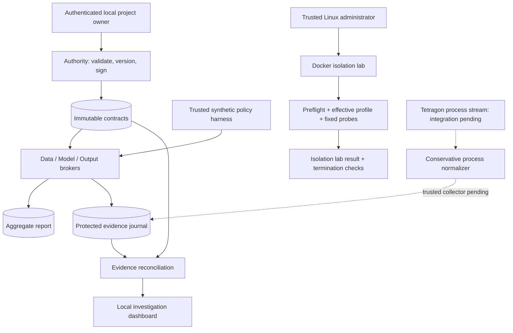

# AgentGuard 2.0 implementation architecture

Version 0.1.0, 24 October 2026. The shared v1 interface from the Linux handoff is the baseline; presentation examples are explanatory only.

The harness and Linux lab are separate, explicitly labeled execution paths. Protected AI execution is not enabled. This prevents the Windows workbench from being mistaken for the project's OS security boundary.

## Code map

| Module | Responsibility | Trust |
|---|---|---|
| `schema.py` | v1 contracts, evidence enums, exact keys, timestamps, size limits | Trusted shared validation |
| `authority.py` | Approver binding, immutable versions, signature/expiry checks | Local owner, not agent |
| `store.py` | SQLite storage, append-only triggers, HMAC chain, dedup | Host-only state |
| `brokers.py` | Approved aggregate retrieval, model interface, strict output release, budgets/revocation | Launcher-bound session |
| `workbench.py` | Synthetic trusted workflow; no untrusted code execution | Policy harness |
| `reconcile.py` | Per-event findings plus independent coverage caveat | Evidence explanation only |
| `platform.py` | Docker create/inspect/start/stop and cgroup verification | Linux administrator |
| `transport.py` | Per-capsule UDS with SO_PEERCRED, UID/cgroup/process-start checks | Linux host; integration pending |
| `sensors.py` | Normalize supported Tetragon process events with trusted lifecycle map | Input authenticity must be established by collector |
| `server.py` | Loopback API, bearer key, origin/Host checks, fixed assets | Local development control plane |

## Evidence semantics

- Trusted broker receipts can establish alignment for their own operation, even when host monitoring is absent.
- A denied and blocked trusted enforcement event is Blocked. It is not a completed transfer.
- Attributable independent effects without a verified authorization match are Unexplained. The current matcher is deliberately conservative: it does not yet match legitimate runtime process activity to policy.
- Incomplete attribution, missing coverage or failed evidence integrity is Unverified.
- All current runs retain an Unverified whole-task finding: no live end-to-end host coverage attestation exists yet.
- A business result and security findings are independent. Multiple findings coexist.

Output storage uses a server-reconstructed summary from trusted synthetic aggregates after validating the submitted summary. Arbitrary text, user-controlled destinations, extra fields and raw rows cannot become approved reports through this broker. Model drafts are not released reports.

## Deployment boundary

The development workbench uses standard-library Python and SQLite to stay runnable without package installation. PostgreSQL, FastAPI, React, hosted/local inference, network anomaly models and enterprise identity are not prerequisites of this first implementation. They can be introduced through explicit interface decisions. No external model request occurs today.

The dashboard is a local developer tool. It is not an internet-facing production API, multi-user identity system or security sensor.
