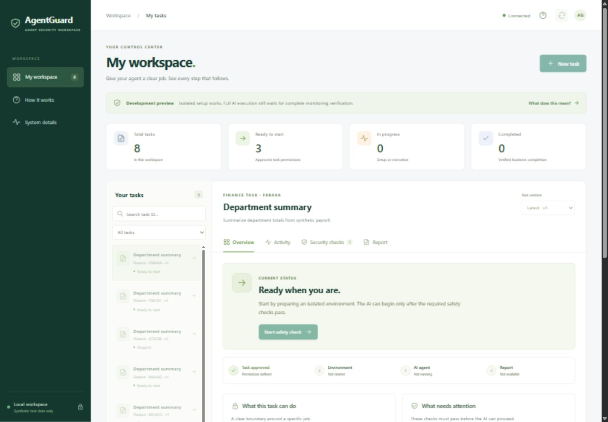

# Recordings and screenshots

All retained demo recordings and presentation screenshots are available here.
These are genuine local application captures using synthetic Finance data.

## Recordings — 25 October 2026

Both recordings use the earlier dashboard. They show restricted bootstrap staging,
an admission hold caused by missing monitoring coverage, and verified cleanup.
They do **not** show a successful admitted Finance agent or released business report.

| Recording | Video | Screenshots |
|---|---|---|
| Latest retained delivery walkthrough | [Watch or download WebM](2026-10-25-delivery-hold/agentguard-delivery-hold.webm) | [Monitoring](2026-10-25-delivery-hold/monitoring.png), [cleanup](2026-10-25-delivery-hold/verified-cleanup.png) |
| Earlier delivery walkthrough | [Watch or download WebM](2026-10-25-delivery-hold-earlier/agentguard-delivery-hold.webm) | [Monitoring](2026-10-25-delivery-hold-earlier/monitoring.png), [cleanup](2026-10-25-delivery-hold-earlier/verified-cleanup.png) |

The latest recording's original check results and timestamps are in
[the recording manifest](../linux/demo_recording.json).
Duplicate `page@…` video exports have identical hashes to the named videos and
are represented by one copy of each distinct recording.

## Screenshots — 26 October 2026

| Image | What it shows |
|---|---|
| [Redesigned desktop workspace](2026-10-26-screenshots/ui-redesign-desktop.png) | New task workspace and overview |
| [Redesigned live overview](2026-10-26-screenshots/ui-redesign-live.png) | Clear status, next action, permissions and progress |
| [Original staging failure](2026-10-26-screenshots/agentguard-walkthrough.png) | The genuine `STAGING_FAILED` result before the fix |
| [Startup progress](2026-10-26-screenshots/staging-progress.png) | Monitoring setup while the AI remains unadmitted |
| [Corrected staging](2026-10-26-screenshots/staging-fixed.png) | Waiting for admission after successful staging |

Original media bytes are preserved. [File hashes and sizes](manifest.json) verify
the 2 recordings and 9 screenshots. Recordings retain masked credential fields;
sampled frames and screenshots were visually reviewed before publication.
Credentials, databases, raw sensor journals, private host state, caches and installed
runtime/dependency binaries remain excluded from Git.
